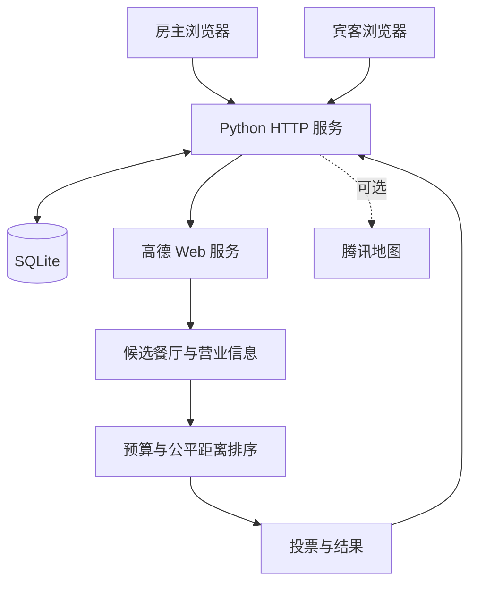
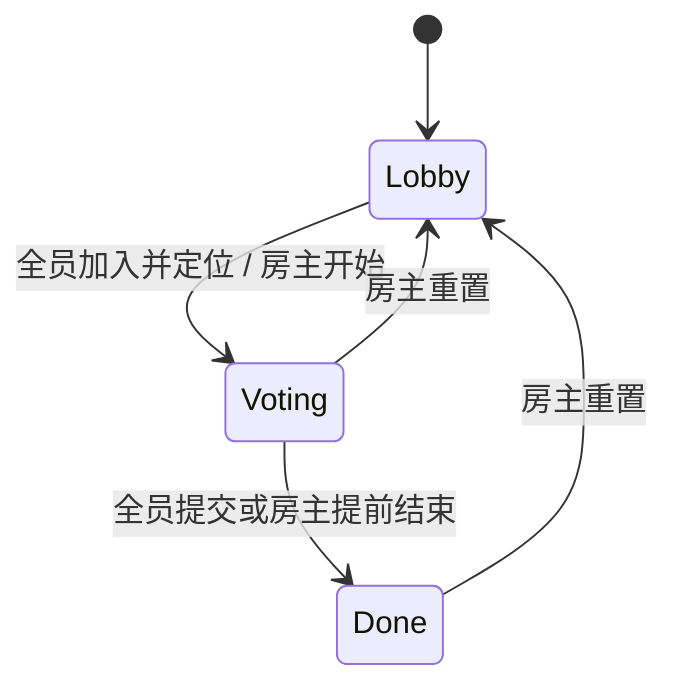

# 架构与算法

## 文件结构

| 文件 | 职责 |
|---|---|
| `server.py` | HTTP、账号、房间、状态校验、投票、持久化 |
| `amap_restaurants.py` | 高德 POI 查询、字段解析、去重与候选筛选 |
| `tencent.py` | 可选腾讯地图适配器 |
| `algorithm.py` | Haversine 距离、预算及推荐排序 |
| `result_order.py` | 确定性拼音/英文同票排序 |
| `commercial.py` | 可选的已核实商家链接记录；不爬取商业平台 |
| `public/` | 移动优先 H5、主题及交互 |
| `test_*.py` / `test_*.cjs` | 自动化回归测试 |

## 房间状态

前端每约 2.5 秒轮询服务端状态。服务端校验成员令牌、房主权限、人数及定位条件。提前结束至少要求一票，未投票者不计票；结束后拒绝继续投票。浏览器令牌是一人一票的实现边界，并不是实名身份认证。

## 推荐算法

1. 将已定位成员的坐标平均值作为检索中心，使用高德真实 POI，搜索范围 0.5–20 km（网页提供 1–20 km 预设）；过滤类别、超范围和明确永久停业记录，去重后最多展示 60 家。不是完整餐厅名录。
2. 对每家餐厅计算各成员的 Haversine 直线距离 d_i（km）。距离代价 D = 0.7 × mean(d_i) + 0.3 × max(d_i)。不是实际通勤距离或时间。
3. 评分效用 R = rating / 5；距离效用 Q = 1 − (D − Dmin)/(Dmax − Dmin)，相等时 Q = 0.5。候选评分优先使用营业且有有效评分的集合确定可用指标与距离范围，缺失项按共同可用指标重新归一化；缺少必要值的候选不产生综合分。
4. 综合分 = 100 × (48.89/51.11 × R + 2.22/51.11 × Q)。权重约 95.66% 和 4.34%；未经可靠验证的人气指标不参与。该权重为产品设计参数，不代表经过科学最优性验证。
5. 综合排序首先按营业状态，再按预算匹配（±20%）、综合分等排序。未知营业状态需房主核实；营业时段只是推断。独立价格排序不受预算分组影响，但仍按营业状态分组。
6. 最终投票结果脱离推荐权重，按票数降序、名称拼音/英文 A–Z、稳定 ID 排序，仅展示有票餐厅，保留投票人名单。

## 已知边界

没有获得商业平台的人气、收藏或销量授权，不使用这些指标。地图信息可能不完整或过期；坐标可以由浏览器或用户手工提供，服务器不能证明物理真实位置或防止恶意位置伪造。服务端为单进程原型，不承诺生产级并发。
